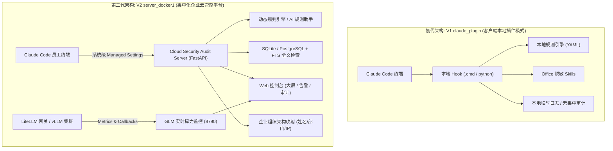

# Cloud Security · 企业级 AI 编码助手安全管控与审计系统

<p align="center">
  
</p>

<p align="center">
  <b>面向 Claude Code 与企业私有化大模型的集中化安全防护、合规脱敏、实时审计与算力监控体系</b>
</p>

<p align="center">
  
  
  
  
  
</p>

---

## 📖 项目简介

**Cloud Security** 是一套专为企业 AI 编程落地（以 Claude Code 为代表）与私有化大模型基础设施设计的**企业级全生命周期安全审计与管控平台**。

随着 AI 编码助手在研发团队的深度普及，企业面临着核心源码泄漏、数据库连接串外泄、内网敏感 IP 暴露、员工非合规提问以及私有算力滥用等严峻挑战。本项目针对企业安全合规的刚性需求，提供从**客户端轻量防护拦截**到**企业级集中化云安全审计与监控**的完整解决方案。

---

## 🚀 版本演进与架构演变 (V1 vs V2)

本项目经历了从**单机客户端插件**到**集中化云原生架构**的重要演进。代码仓库完整保留了两个版本的实现，便于企业按需选择或平滑过渡：



### 版本深度对比

| 核心维度 | V1: `claude_plugin` (初代版本) | V2: `server_docker1` (第二代生产版本) |
| :--- | :--- | :--- |
| **架构形态** | 客户端独立插件（Local Plugin） | 客户端托管策略 + 服务端集中微服务（Docker化） |
| **部署位置** | 开发者单机 `%USERPROFILE%\.claude\plugins\` | 服务端集中部署（Docker Compose），客户端一键配置 |
| **控制力/防绕过** | 弱（员工可本地手动修改配置或卸载插件） | **极强（通过系统级 Managed Settings 强制注入，不可旁路）** |
| **安全策略下发** | 依赖版本升级更新或本地 YAML 分发 | **服务端 Web 界面实时热更新，毫秒级全局生效** |
| **审计与态势感知** | 仅单机本地日志，无全局汇总与检索能力 | **集中入库，内置 FTS 全文检索、风险告警看板与行为分析** |
| **AI 赋能** | 静态正则扫描 + 本地 LLM 文档脱敏 | **内置 AI 规则助手（自然语言自动生成正则与单元测试）** |
| **模型算力监控** | 无 | **内置 GLM Monitor（vLLM 实例负载、LiteLLM 流量与在途请求监控）** |
| **组织架构关联** | 无 | **自动映射部门、工号、员工真实姓名及资产主机名** |
| **适用场景** | 个人开发者、小团队快速 PoC 验证、离线单机场景 | **中大型企业研发团队规模化推广、合规风控落地** |

---

## 🛠️ 项目目录结构

```
cloud_security/
├── README.md                      # 项目全局全景说明文档（本文件）
├── .gitignore                     # Git 忽略配置（脱敏与缓存过滤）
│
├── claude_plugin/                 # 【V1 版本】Claude Code 客户端安全插件
│   ├── .claude-plugin/            # 插件元数据（plugin.json / marketplace.json）
│   ├── bin/                       # 跨环境启动脚本（input_scanner.cmd / output_scanner.cmd）
│   ├── config/                    # 外部化规则配置
│   ├── deploy/                    # 早期客户端部署辅助脚本
│   ├── hooks/                     # Claude Code Hook 注册定义（hooks.json）
│   ├── skills/                    # Office 文档敏感数据智能脱敏 Skill (Word/PPT/Excel)
│   ├── src/                       # 核心检测器、脱敏策略与更新管理器源码
│   └── README.md                  # V1 插件使用指南与技术细节
│
└── server_docker1/                # 【V2 版本】企业级集中化云安全管控服务端
    ├── claude_audit/              # 主审计服务（FastAPI 后端 + Web 控制台 + 规则引擎）
    │   ├── api/                   # RESTful API、Web 路由、Jinja2 模板与静态资源
    │   ├── detector/              # 核心安全检测器与 AI 规则助手 (AI Rule Assistant)
    │   ├── storage/               # 数据库持久化、FTS 搜索、每日自动备份与归档
    │   └── config.yml             # 服务端配置文件
    ├── client/                    # 客户端一键分发部署套件 (Windows Managed Settings)
    ├── docker/                    # Dockerfile、docker-compose.yml 与持久化配置
    ├── glm_monitor/               # 私有化大模型集群监控服务 (vLLM / LiteLLM 监控看板)
    ├── DEPLOYMENT.md              # V2 服务端部署完整手册
    ├── CLIENT_DEPLOYMENT_MANUAL.md# 客户端企业批量分发指南
    └── MONITORING_GUIDE.md        # 算力与模型网关监控接入指南
```

---

## 🌟 核心功能特性

### 1. 全方位敏感数据防泄露 (DLP)
- **多阶段 Hook 拦截**：在用户提问前（`UserPromptSubmit`）、工具执行前（`PreToolUse`）、工具执行后（`PostToolUse`）以及会话结束（`Stop`）实施四层立体拦截。
- **高危行为熔断**：阻断对敏感目录（如 `/etc/shadow`、`~/.ssh/`）的读取、外部未知网络的危险请求（如向未知公网 IP POST 数据）、高危 Shell 破坏性指令。
- **智能脱敏引擎**：自动对手机号、身份证、邮箱、内网私有 IP、API Key、密码、JWT Token 等敏感信息进行掩码脱敏。

### 2. 集中化安全运营与审计看板 (Web Console)
- **数据大屏与趋势图表**：实时展示全局请求量、拦截阻断率、高频告警规则分布。
- **全量日志全文检索 (FTS)**：支持毫秒级检索历史上下文交互内容、工具入参与出参。
- **组织架构智能关联**：将终端机器名或系统账户自动映射到所属部门、员工真实姓名，审计溯源到人。

### 3. AI 规则助手 (Natural Language to Security Rules)
- 集成大模型语义理解能力，安全管理员只需输入自然语言（例如：“*禁止在提问中包含公司数据库内网连接地址，必须阻断*”）。
- 系统自动生成合规的**正则表达式、拦截动作、风险等级**及**正反向自动化测试用例**，一键审核入库上线。

### 4. 私有化大模型与算力监控 (GLM Monitor)
- **零依赖极简服务**：单文件纯 Python 标准库编写，无需额外 pip 依赖。
- **集群状态洞察**：对接 vLLM 实例（GPU 显存使用率、KV Cache 占用率、等待队列、吞吐 TPS）。
- **实时在途请求追踪 (Inflight Requests)**：配合 LiteLLM 网关回调，秒级洞察当前集群正在处理的并发会话。

---

## ⚡ 快速开始 (Quick Start)

### 选项 A：部署 V2 企业级集中管控平台（推荐）

#### 1. 服务端 Docker Compose 一键启动
进入 `server_docker1/docker` 目录，启动审计主平台与监控大屏：

```bash
cd server_docker1/docker

# 构建镜像并后台拉起容器服务
docker compose up -d --build

# 检查容器运行状态 (Up 8787, 8790)
docker compose ps
```

- **安全审计控制台**：浏览器访问 `http://<服务器IP>:8787`（默认账号：`admin`，默认密码：`admin2026`）
- **模型监控大屏**：浏览器访问 `http://<服务器IP>:8790`

#### 2. 客户端批量配置注入
进入 `server_docker1/client` 目录，将部署包下发到研发员工 Windows 电脑：
- 右键以管理员身份运行 `1_一键安装.bat`。
- 脚本将自动注入 Windows `C:\ProgramData\ClaudeCode\managed-settings.json`，完成企业安全网关的无感挂载与强制纳管。
- 运行 `2_测试连通性.bat` 验证客户端与服务端审计链路畅通。

---

### 选项 B：体验 V1 客户端本地独立插件

如果您仅需在个人电脑或离线测试环境中快速试用单机拦截能力：

1. 进入 `claude_plugin` 目录：
   ```bash
   cd claude_plugin
   pip install -r src/input/requirements.txt
   ```
2. 在 Claude Code 终端中链接并加载该插件：
   ```cmd
   mklink /D "%USERPROFILE%\.claude\plugins\cloud-guard" "E:\cloud_security\claude_plugin"
   ```
3. 在 Claude Code 交互会话中输入 `/plugin` 启用 `cloud-guard`，即可体验本地输入输出拦截与 Office 脱敏工具。

---

## 🛡️ 安全与合规建议

1. **生产密码修改**：上线前请务必在 `server_docker1/docker/docker-compose.yml` 中修改 `AUDIT_ADMIN_PASSWORD` 与 `AUDIT_SESSION_SECRET`。
2. **上报 Token 保护**：在 `server_docker1/docker/config.yml` 中更新 `ingest.token`，并同步更新客户端模板中的请求头凭据。
3. **数据冷热备份**：系统内置自动备份机制（每日凌晨自动执行 SQLite 热备份并在保留期后归档），确保审计凭证不可篡改。

---

## 📄 开源许可证

本项目采用 [MIT License](LICENSE) 开源协议。
